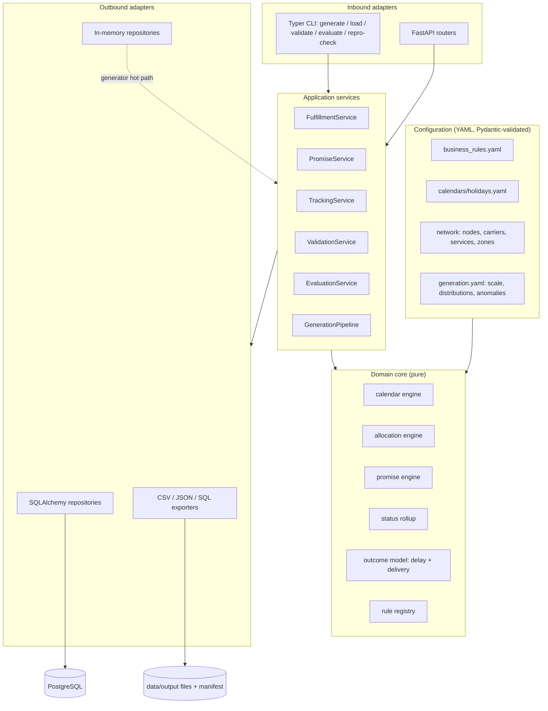
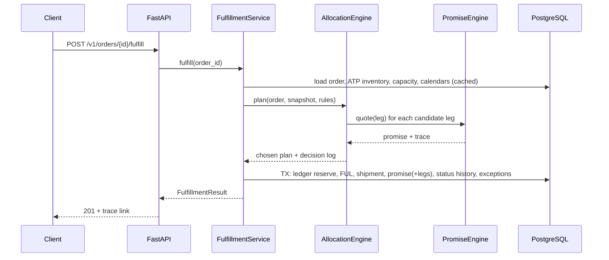

# 02 — Architecture, Modules, Directory Structure

## 1. Architectural style

Layered / hexagonal ("ports and adapters") modular monolith. The business engine is a **pure-Python domain core** (no I/O), so the same code path serves the generator (batch simulation), the API (online) and the tests.



Key choices (each becomes an ADR in `docs/adr/`):

| Decision | Choice | Why |
|---|---|---|
| Generator vs DB | Generator simulates **in memory** (NumPy/dataclasses), exports files, then bulk loads via `COPY` | 50k orders × allocation logic through ORM would be slow and non-deterministic on ordering; the DB is a persistence target, not the simulator |
| Engine reuse | Same `allocation` + `promise` domain code used by generator and API | One source of truth; generated outcomes come from the real rules (problem statement: "from documented rules, not independent random assignment") |
| Rules | YAML → Pydantic `BusinessRules` object injected everywhere | No scattered constants (NFR-03) |
| Time | All stored timestamps UTC `timestamptz`; calendar maths in node/carrier IANA time zone; a `Clock` port (simulation clock vs system clock) | Determinism, DST correctness |
| History | Append-only tables; "current state" is a view/derivation | Problem statement rule 4 |
| Ground truth | Separate schema `gt` and separate files; engine/validator packages cannot import it (import-linter contract) | "never leak into input features" |
| Money | `Decimal` / `NUMERIC(12,2)` | No float rounding drift |
| IDs | Pure functions `IdFactory(prefix, year, width)`; counters allocated in deterministic order | Immutable, reproducible |

## 2. Runtime view (API mode)



Concurrency: reservation uses `SELECT … FOR UPDATE` on inventory rows ordered by `(node_id, sku_id)` (deadlock-safe), with an idempotency key on `POST /fulfill`.

## 3. Deployment view

Docker Compose: `postgres:16` + `app` (uvicorn). `make` targets wrap everything. No paid services.

## 4. Module breakdown

| Module (`src/fulfillment/…`) | Responsibility | Depends on |
|---|---|---|
| `config/` | Pydantic models + loaders for all YAML; config hashing; schema validation | — |
| `domain/models/` | Immutable dataclasses / enums for entities, statuses, value objects | — |
| `domain/calendar/` | Working-day arithmetic, holiday resolution, cutoff evaluation, DST-safe conversions | models, config |
| `domain/allocation/` | Candidate generation, ATP calc, single vs split planner, scoring, tie-break | calendar, promise, config |
| `domain/promise/` | Processing-day search with capacity, carrier cutoff, transit, delivery-day snap, buffer, trace | calendar, config |
| `domain/outcomes/` | Carrier delay model, actual delivery calc, tracking event template expansion | calendar, config |
| `domain/rollup/` | Order/shipment status derivation (table driven) | config |
| `domain/exceptions.py` | Typed domain errors + `ExceptionRecord` factory | — |
| `services/` | Orchestrate use-cases, transactions, logging | domain, ports |
| `ports/` | Repository / Clock / IdFactory / Unit-of-work protocols | models |
| `adapters/db/` | SQLAlchemy 2.0 models, repositories, bulk loader (`COPY`) | ports |
| `adapters/memory/` | In-memory repositories (generator, unit tests) | ports |
| `adapters/export/` | Deterministic CSV/JSON/SQL writers, manifest, checksums | models |
| `generation/` | Pipeline stages, RNG stream factory, distributions, Faker providers, anomaly injector, ground-truth writer | domain, adapters |
| `validation/` | Rule classes (`Rule.check(dataset) -> list[Finding]`), runner, summary report | models (never `gt`) |
| `evaluation/` | Business metrics + detection scoring against ground truth | validation, gt files |
| `api/` | Routers, schemas (Pydantic v2), dependency injection, problem-details handlers | services |
| `cli/` | Typer commands | services |
| `observability/` | Logging config, run-id context var, timing decorators | — |

Dependency rule (enforced by `import-linter`): `domain` imports nothing outside `domain`/`config`; `validation` and `domain` may not import `evaluation` or ground-truth readers.

## 5. Configuration-driven rules

```
config/
  business_rules.yaml      # allocation weights, split policy, buffers, rollup table, status transitions
  network/nodes.yaml       # 20 nodes (region, tz, cutoffs, handling, calendar ref)
  network/carriers.yaml    # 10 carriers, service levels, delay profiles
  network/zones.yaml       # region→region zone matrix, transit table per service×zone
  calendars/holidays.yaml  # holiday sets per calendar with provenance
  generation.yaml          # scale, windows, distributions, anomaly counts
  logging.yaml
```

Sketch of `business_rules.yaml` (values are **placeholders to be justified in the assumption register**, not final numbers):

```yaml
allocation:
  prefer_single_node: true
  split_if_promise_gain_days_at_least: 2      # A-10
  max_split_nodes: 3
  score_weights: {promise_delay_days: 1.0, shipping_cost: 0.2, split_penalty: 1.5, node_load: 0.1}
  tie_break: [score, promise_date, node_code]
  atp: {include_safety_stock: true, include_inbound: false}
  partial_fulfillment_default: false
promise:
  order_release_lag_minutes: 15
  buffer_days_by_reliability_band: {high: 0, medium: 1, low: 2}
  capacity_lookahead_days: 14
status_rollup:           # order-level delivery status from shipment statuses (table-driven)
  - {when: all_delivered, status: DELIVERED}
  - {when: some_delivered_some_open, status: PARTIALLY_DELIVERED}
  - ...
lifecycle:
  shipment_transitions: {PLANNED: [PACKED, CANCELLED], ...}
```

A CI gate greps `src/` for date/size/threshold literals outside `config/` and `tests/`.

## 6. Project directory structure

```
order-fulfillment-promise/
├── README.md                      # setup, run, verify, limitations
├── pyproject.toml                 # deps, ruff, mypy, pytest, import-linter
├── Makefile                       # make setup | gen | load | validate | eval | repro | test | api
├── docker-compose.yml             # postgres + app
├── .env.example
├── alembic.ini
├── alembic/versions/              # 0001 reference, 0002 transactional, 0003 history, 0004 gt, 0005 views/indexes
├── config/                        # see §5
├── docs/
│   ├── 00_assumptions.md
│   ├── architecture.md            # from this plan
│   ├── data_dictionary.md         # GENERATED from schema spec (no drift)
│   ├── er_diagram.md
│   ├── business_rules.md          # human-readable mirror of YAML
│   ├── adr/                       # ADR-001.. decisions
│   ├── validation_summary.md      # GENERATED
│   ├── reproducibility_report.md  # GENERATED (run1 vs run2)
│   ├── source_manifest.md         # provenance: all synthetic; references cited
│   └── ai/
│       ├── AI_USAGE.md            # where AI accelerated / relied / reviewed / changed
│       └── prompt_history/        # every prompt, dated, per tool
├── src/fulfillment/               # modules from §4
│   ├── config/ domain/ services/ ports/ adapters/{db,memory,export}/
│   ├── generation/{stages,providers,anomalies}/
│   ├── validation/rules/ evaluation/ api/{routers,schemas} cli/ observability/
├── tests/
│   ├── unit/                      # calendar, allocation, promise, rollup, outcomes, config
│   ├── property/                  # hypothesis: calendar monotonicity, promise >= order time
│   ├── integration/               # PG load, FK/CHECK, API flows, validator-vs-ground-truth
│   ├── golden/                    # small-scale expected CSV + checksums
│   └── conftest.py
├── data/
│   ├── starter/                   # small committed sample (e.g. 500 orders) for quick review
│   └── output/                    # full dataset (git-ignored; reproducible by `make gen`)
│       ├── csv/ json/ sql/ ground_truth/ manifest.json checksums.sha256
└── scripts/                       # bench.py, repro_check.sh
```
