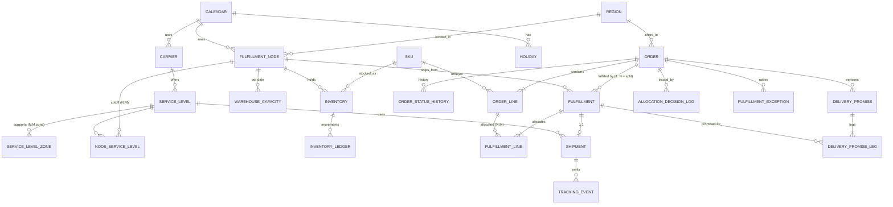

# 03 — Database Architecture & Entity Relationships

## 1. Principles

1. PostgreSQL 16, SQLAlchemy 2.0 (typed `Mapped[]`), Alembic migrations (no `create_all`).
2. Schemas: `ref` (master/reference), `txn` (orders, fulfillment, shipments, promises), `hist` (append-only events), `gt` (ground truth — separate schema, separate grants), `meta` (runs, manifests, validation results).
3. Natural business keys are the **primary keys** (e.g. `order_id = 'ORD-2026-000001'`), so IDs are stable and exports/joins match exactly (problem statement Step 3).
4. Every relationship has a declared FK; every enum has a `CHECK` or PG enum; every date-order rule that can be a `CHECK` is one.
5. Effective-dating on slowly changing reference rows (`effective_from`, `effective_to` — half-open `[from, to)`, exclusion constraint prevents overlaps).
6. Append-only: `hist.*`, `txn.delivery_promise`, `txn.inventory_ledger`, `hist.tracking_event` have a trigger rejecting `UPDATE/DELETE`.
7. Derived columns (order totals, shipment status) are either generated columns/views or written once by services from source rows; validators re-derive and compare.

## 2. ID conventions (config: `id_formats`)

| Entity | Format | Example |
|---|---|---|
| Order | `ORD-{year}-{seq:06}` | `ORD-2026-000001` |
| Fulfillment (see A-01) | `FUL-{year}-{seq:06}` | `FUL-2026-000001` |
| Shipment | `SHP-{year}-{seq:06}` | `SHP-2026-000001` |
| TrackingEvent | `TRK-{shipment_id}-{seq:03}` | `TRK-SHP-2026-000001-001` |
| DeliveryPromise | `PROM-{order_id}-{version:02}` | `PROM-ORD-2026-000001-01` |
| OrderLine *(assumed)* | `{order_id}-L{n:02}` | `ORD-2026-000001-L01` |
| SKU / Node / Carrier / ServiceLevel *(assumed)* | `SKU-{:06}` / `NODE-{:03}` / `CAR-{:02}` / `SVC-{carrier}-{code}` | `NODE-007` |

Counters are assigned in a single deterministic pass (orders by `placed_at, tiebreak index`) and never reused.

## 3. Tables

Type legend: `T`=text, `TS`=timestamptz(UTC), `D`=date, `I`=int, `N`=numeric, `B`=bool. **R**=required, **O**=optional.
Full field-level data dictionary (type, required, allowed values, units, uniqueness, validation) is **generated** into `docs/data_dictionary.md` from one schema-spec module that also drives SQLAlchemy models and validators — so docs cannot drift. Below is the design-level dictionary of the 11 core entities.

### 3.1 Core entities

**SKU** (`ref.sku`) — PK `sku_id`
| Field | Type | Req | Rule |
|---|---|---|---|
| sku_id | T | R | `SKU-######`, unique |
| sku_name | T | R | Faker-generated product name (synthetic) |
| category | T | R | enum from config |
| unit_weight_kg | N(8,3) | R | > 0 |
| unit_volume_l | N(8,3) | R | > 0 |
| unit_price | N(12,2) | R | ≥ 0, currency per config |
| handling_units | N | R | capacity units consumed per piece (config per category) |
| is_active / effective_from / effective_to | B/D/D | R | from < to |

**FulfillmentNode** (`ref.fulfillment_node`) — PK `node_id`
| node_id `NODE-###` · node_name · node_type (`WAREHOUSE`,`STORE`,`DC`) · region_id FK · timezone (IANA) · calendar_id FK · pick_cutoff_local (time) · open_time_local · handling_hours (N) · status (`ACTIVE`,`SUSPENDED`,`CLOSED`) · effective_from/to |
Rule: `handling_hours` ≥ 0; timezone must be valid IANA; one active row per node at any date.

**Inventory** (`ref.inventory`, effective-dated snapshot) — PK `(node_id, sku_id, effective_from)`
| on_hand_qty I≥0 · reserved_qty I≥0 · safety_stock_qty I≥0 · reserved ≤ on_hand · effective_from/to |
Changes happen through `txn.inventory_ledger` (`RECEIPT`,`RESERVE`,`RELEASE`,`SHIP`,`ADJUST`) with `qty_delta`, `balance_after`; snapshot reconciles to ledger.

**WarehouseCapacity** (`ref.warehouse_capacity`) — PK `(node_id, capacity_date)`
| max_units I>0 · max_orders I>0 · source (`BASE`,`HOLIDAY_REDUCED`,`OUTAGE`) | `used_*` derived by view `txn.v_capacity_usage` from fulfillment lines at processing date (never stored independently). |

**Carrier** (`ref.carrier`) — PK `carrier_id` `CAR-##`
| carrier_name · calendar_id FK · pickup_days / delivery_days (via calendar) · reliability_band (`HIGH`,`MEDIUM`,`LOW`) · delay_profile_id FK · status · effective dates |

**ServiceLevel** (`ref.service_level`) — PK `service_level_id`; FK `carrier_id`
| code (`GROUND`,`EXPRESS`,`OVERNIGHT`,`ECONOMY`…) · transit_day_type (`BUSINESS`,`CALENDAR`) · tracking_detail (`BASIC`,`STANDARD`,`FULL`) · max_weight_kg · effective dates |
Bridge `ref.service_level_zone` PK `(service_level_id, zone_code)`: `supported B`, `transit_days_min I`, `transit_days_max I`, `rate_base N`, `rate_per_kg N`. Check: if `supported` then transit fields NOT NULL and `min ≤ max`.
Bridge `ref.node_service_level` PK `(node_id, service_level_id, effective_from)`: `cutoff_local_time`, `pickup_days_override`.

**Order** (`txn.order`) — PK `order_id`
| placed_at TS R · channel enum · customer_ref T (opaque synthetic) · ship_to_region_id FK · ship_to_postal (synthetic) · ship_to_zone derived? (no — zone derived per leg) · requested_service_level_id FK O · requested_delivery_by D O · allow_partial B · currency · order_total N (**derived** = Σ line totals) · status (current, derived from `hist.order_status_history`) |

**OrderLine** (`txn.order_line`) — PK `order_line_id`; FK `order_id`, `sku_id`
| line_no I (unique per order) · qty I>0 · unit_price N · line_total N (**derived** = qty×unit_price) · line_status |

**Fulfillment** (`txn.fulfillment`) — PK `fulfillment_id`; FK `order_id`, `node_id`; (A-01)
| allocated_at TS · plan_id/leg_no I · status (`ALLOCATED`,`PICKING`,`PACKED`,`SHIPPED`,`CANCELLED`) · planned_process_date D · capacity_units_used I (**derived** from lines × SKU handling_units) |
Bridge `txn.fulfillment_line` PK `(fulfillment_id, order_line_id)`: `qty_allocated I>0`. This is the **N:M bridge** between OrderLine and Fulfillment (a line can be split across nodes).

**Shipment** (`txn.shipment`) — PK `shipment_id`; FK `fulfillment_id` (UNIQUE, 1:1), `service_level_id`, `carrier_id`
| zone_code · planned_ship_date D · dispatched_at TS O · actual_delivered_at TS O · status (derived from last tracking event) · tracking_number T · delay_cause enum O |
Checks: `actual_delivered_at ≥ dispatched_at` (the DB check exists but the anomaly loader uses a no-check staging path; see §4).

**TrackingEvent** (`hist.tracking_event`) — PK `tracking_event_id`; FK `shipment_id`
| sequence_no I (unique per shipment) · event_type enum · event_ts TS · location_code O · status_after enum · source (`CARRIER`,`WMS`) · detail O |
Unique `(shipment_id, sequence_no)`; id suffix = sequence_no.

**DeliveryPromise** (`txn.delivery_promise`) — PK `promise_id`; FK `order_id`
| version I (unique per order) · calculated_at TS · promised_delivery_date D · earliest_date / latest_date D · reason (`INITIAL`,`RE_PROMISE_DELAY`,`RE_PROMISE_SHORTAGE`) · rules_version T · supersedes_promise_id FK O |
Child `txn.delivery_promise_leg` PK `(promise_id, fulfillment_id)`: `process_date, ship_date, delivery_date, cutoff_met B, capacity_rolled_days I, transit_days I, buffer_days I, trace_json`.

### 3.2 Supporting tables (needed by the rules, not in the 11-entity list)

| Table | Purpose |
|---|---|
| `ref.region`, `ref.zone_matrix(origin_region, dest_region → zone_code)` | Shipping zones |
| `ref.calendar`, `ref.calendar_day_rule(calendar_id, weekday, is_working, open/close)`, `ref.holiday(calendar_id, date, name, closed B, scope)` | Working-day & holiday logic |
| `ref.delay_profile` | Per-carrier delay probabilities/magnitudes by cause (config-sourced) |
| `txn.inventory_ledger` | Append-only inventory movements |
| `txn.allocation_decision_log` | Candidates, scores, rejection reasons (traceability) |
| `txn.fulfillment_exception` | Typed exception records with lifecycle (`OPEN`,`ACKNOWLEDGED`,`RESOLVED`) |
| `hist.order_status_history` | Append-only order status changes |
| `gt.ground_truth_label` | Anomaly labels (issue_id, issue_type, entity, entity_id, field, original/injected value, expected rule, scenario no.) |
| `meta.run`, `meta.dataset_manifest`, `meta.validation_run`, `meta.validation_finding` | Runs, checksums, validation output |

### 3.3 Cardinality

| Relationship | Cardinality | Optionality |
|---|---|---|
| Order → OrderLine | 1:N | line mandatory (≥1) |
| SKU → OrderLine | 1:N | — |
| Order → Fulfillment | 1:N | 0 if backordered/unfulfillable; >1 = split |
| OrderLine ↔ Fulfillment | **N:M** via `fulfillment_line` | — |
| FulfillmentNode → Fulfillment | 1:N | — |
| Fulfillment → Shipment | 1:1 | shipment created once packed/planned |
| Carrier → ServiceLevel | 1:N | — |
| ServiceLevel ↔ Zone | **N:M** via `service_level_zone` | `supported=false` rows explicit |
| FulfillmentNode ↔ ServiceLevel | **N:M** via `node_service_level` | — |
| SKU ↔ FulfillmentNode | **N:M** via `inventory` | — |
| FulfillmentNode → WarehouseCapacity | 1:N (per date) | — |
| Shipment → TrackingEvent | 1:N | ≥1 once dispatched |
| Order → DeliveryPromise | 1:N (versions) | ≥1 once allocated |
| DeliveryPromise → PromiseLeg → Fulfillment | 1:N, N:1 | — |

## 4. Anomaly loading vs constraints

DB `CHECK`s would reject the injected anomalies. Strategy: (a) the **file/SQL exports always contain anomalies** (that is the deliverable); (b) a DB load has two modes: `--mode=clean` (loads baseline only, constraints on) and `--mode=with-anomalies` (loads into `*_staging` shadow tables without the violating CHECKs plus FK-valid rows, then `INSERT … SELECT` into main tables with the affected CHECKs created `NOT VALID`). The validator runs the same rules over both. Anomaly rows still satisfy PK/FK, so *only* the intended rule is violated.

## 5. Entity relationship overview

## 6. Indexing & performance

* FK columns indexed; composite `(node_id, sku_id)` on inventory; `(node_id, capacity_date)` PK on capacity; `(shipment_id, sequence_no)` unique on tracking; `(order_id, version)` unique on promise.
* Partial index on open exceptions. BRIN on `tracking_event.event_ts`.
* Bulk load: `COPY` in dependency order, then `ANALYZE`; FKs validated after load for speed (`DEFERRABLE INITIALLY DEFERRED`).

## 7. Alembic plan

`0001_ref_schema` → `0002_txn_schema` → `0003_hist_and_triggers` (append-only) → `0004_gt_and_meta` → `0005_views_indexes`. Each migration reversible; CI runs `upgrade head → downgrade base → upgrade head`.

## 8. Lifecycle state machines (config-driven)

* **Order:** CREATED → ALLOCATED → PARTIALLY_SHIPPED → SHIPPED → PARTIALLY_DELIVERED → DELIVERED; CREATED/ALLOCATED → BACKORDERED | UNFULFILLABLE | CANCELLED.
* **Fulfillment:** ALLOCATED → PICKING → PACKED → SHIPPED; any pre-ship → CANCELLED.
* **Shipment:** PLANNED → PACKED → DISPATCHED → IN_TRANSIT → OUT_FOR_DELIVERY → DELIVERED; IN_TRANSIT/OUT_FOR_DELIVERY → DELIVERY_EXCEPTION → (IN_TRANSIT | RETURNED_TO_SENDER).
Transitions are data (`lifecycle:` in YAML) and enforced both in services and the validator.
