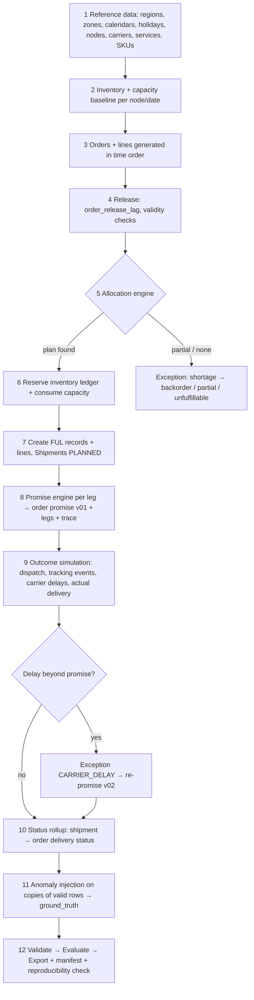
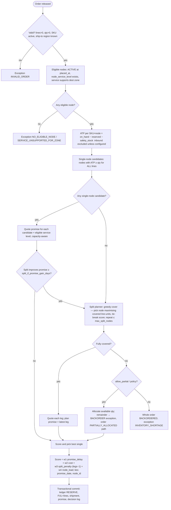
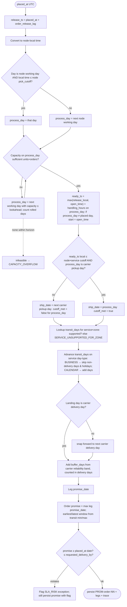

# 04 — Business Workflow, Allocation, Promise, Exceptions

## 1. End-to-end business workflow



Mapping to the problem statement's workflow: step 1–2 = "generate master data first"; 3–9 = "generate dependent records with valid parent IDs, apply business logic"; every state change is an appended record (rule 4); outcomes derive from rules (rule 5).

The simulation processes orders in `(placed_at, order_seq)` order so inventory depletion, replenishment receipts and capacity consumption are causally consistent.

## 2. Fulfillment allocation decision flow



Determinism rules: candidate lists are sorted by `node_id`; scores are `Decimal`; ties are resolved by the configured `tie_break` list — never by dict/set order or RNG.

**Capacity handling inside allocation:** a leg is feasible on day *D* only if `used_units(D)+leg_units ≤ max_units(D)` and `used_orders(D)+1 ≤ max_orders(D)`. If not, the promise engine rolls the processing day forward (up to `capacity_lookahead_days`); each rolled day is recorded (`capacity_rolled_days`) and adds to promise delay, which the scorer sees — so capacity pressure naturally steers orders to other nodes. If no day in the horizon fits ⇒ leg infeasible ⇒ `CAPACITY_OVERFLOW` exception and that node is dropped from candidates.

## 3. Delivery promise calculation flow

Per leg (node *n*, service level *s*), all arithmetic uses calendars; every step writes to `trace_json`.



Rules worth stating explicitly:
* **Zone** = `zone_matrix[node.region, order.ship_to_region]`; unsupported (`supported=false` or missing) ⇒ the service is removed from candidates, never silently defaulted.
* **Cutoff** compared in node-local time; DST handled via `zoneinfo`; a `cutoff_met=false` is not an error, it's a rolled day with trace.
* **Holidays:** node holidays move *processing*; carrier holidays move *pickup* and *delivery*; both calendars are consulted independently.
* **Buffer** = lookup of carrier `reliability_band` in config (A-09); `0` allowed.
* **Re-promise:** on `CARRIER_DELAY` exceptions the engine recomputes from the current position (dispatched_at, delay event) and appends v(N+1) with `supersedes_promise_id`; v01 is never edited.
* **Actual outcome (not promise):** `actual_delivery = planned_delivery_without_delay + delay_days(delay profile)` re-snapped to carrier delivery calendar; delay cause label stored. Promise and outcome therefore differ *by rule*, producing a measurable on-time metric.

## 4. Exception handling strategy

### 4.1 Two kinds of "exception"

| Kind | Meaning | Handling |
|---|---|---|
| **Business exceptions** (runtime) | Valid situations the system must handle: shortage, capacity overflow, unsupported service/zone, carrier delay, promise at risk | Typed `fulfillment_exception` record + deterministic remedy + status history; processing continues |
| **Data anomalies** (injected) | Corrupt/contradictory records for testing detection | Labelled in ground truth; detected by validator; never produced by the engine |
| **Technical errors** | Bad config, DB failure, invalid input | Domain error hierarchy; fail fast (generator) or RFC 7807 response (API); logged with run ID |

### 4.2 Business exception catalogue

| Code | Detection | Remedy (config) | Resulting state |
|---|---|---|---|
| `INVENTORY_SHORTAGE` | ATP < qty on all single nodes and split cannot cover | partial (if `allow_partial`) else backorder | Order BACKORDERED / partial |
| `CAPACITY_OVERFLOW` | No capacity day within lookahead | drop node; try next candidate; else backorder | exception OPEN |
| `SERVICE_UNSUPPORTED_FOR_ZONE` | `service_level_zone.supported=false` | exclude service; fall back to next service level | candidate removed |
| `NO_ELIGIBLE_NODE` | eligibility filter empty | UNFULFILLABLE | terminal |
| `CARRIER_DELAY` | tracking delay event / delivery > promise | re-promise v+1 | exception RESOLVED on re-promise |
| `PROMISE_MISS` | actual > promised (after buffer) | record only (KPI) | metric |
| `SLA_RISK` | promise > requested_delivery_by | record + flag | exception OPEN |
| `INVALID_ORDER` | validation | reject | CANCELLED |

### 4.3 Technical error taxonomy

```
FulfillmentError
├── ConfigurationError          (invalid/missing YAML value → exit code 2 / startup failure)
├── DomainRuleViolation
│   ├── InsufficientInventoryError
│   ├── CapacityExceededError
│   ├── UnsupportedServiceZoneError
│   └── InvalidLifecycleTransitionError
├── NotFoundError               (→ 404)
├── ConflictError / IdempotencyError  (→ 409)
└── PersistenceError            (→ 503, retriable flag)
```

* API: global handlers map to RFC 7807 (`type`, `title`, `status`, `detail`, `instance`, `run_id`).
* Services never swallow exceptions; they either convert to a business-exception record (expected outcomes) or re-raise.
* Transactions: one unit of work per fulfill call; rollback on any error; exceptions-as-records written *in the same* transaction as the decision they explain.
* Generator: stage-level try/except logs stage, counts, config hash, then aborts non-zero — never emits a partially valid dataset.
* Logging: JSON lines, fields `ts, level, run_id, stage, order_id, event`; INFO per stage summary, DEBUG per decision, WARNING per business exception, ERROR per technical error. Per-record INFO is prohibited (50k orders).
